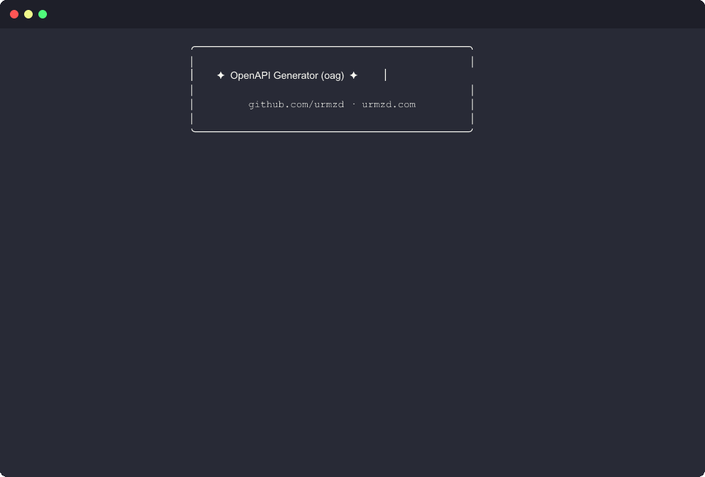

<p align="center">
  <h1 align="center">oag</h1>
  <p align="center">
    OpenAPI 3.x code generator. TypeScript, React, Python FastAPI.
    <br /><br />
    <a href="https://github.com/urmzd/oag/releases">Download</a>
    &middot;
    <a href="https://github.com/urmzd/oag/issues">Report Bug</a>
    &middot;
    <a href="https://github.com/urmzd/oag/tree/main/examples">Examples</a>
  </p>
</p>

<p align="center">
  <a href="https://github.com/urmzd/oag/actions/workflows/ci.yml"></a>
  <a href="https://crates.io/crates/oag"></a>
  &nbsp;
  <a href="LICENSE"></a>
</p>

<p align="center">
  
</p>

## Why oag?

Most OpenAPI generators produce bloated output that needs heavy post-processing. `oag` generates clean, readable code from one config file with one command.

- Parses OpenAPI 3.x specs with full `$ref` resolution
- Template pack engine — generators are Jinja2 templates, no Rust code needed
- Built-in packs: `node-client`, `react-swr-client`, `fastapi-server`
- First-class SSE support (`AsyncGenerator` in TS, `StreamingResponse` in Python)
- Literal-faithful output — a `const` or single-value `enum` (a discriminator like `type: "message"`) is always emitted with its value: required in TypeScript, `Literal["x"] = "x"` in Pydantic — never silently optional or empty
- Packs install locally to `.oag/packs/` — version them, share them, customize them

## Install

```sh
curl -fsSL https://raw.githubusercontent.com/urmzd/oag/main/install.sh | sh
```

The installer verifies the binary against the release's `SHA256SUMS` and aborts on a mismatch or when the checksums are missing. `SHA256SUMS` comes from the same GitHub release over the same HTTPS connection, so it catches a corrupted download or a swapped CDN object, not a compromised release or release token. `oag update` checks the same checksums (each asset's `.sha256` sidecar, else `SHA256SUMS`) and refuses an update without them.

| Variable | Effect |
|----------|--------|
| `OAG_VERSION` | Version to install, e.g. `v0.21.0`. Defaults to the latest release. |
| `OAG_INSTALL_DIR` | Install directory. Defaults to `$HOME/.local/bin`. |
| `OAG_DOWNLOAD_URL` | Base URL of the release downloads, for a mirror. Must be `https://` (plain `http://` only for `127.0.0.1` or `localhost`). |
| `OAG_SKIP_VERIFY` | **Unsafe.** `1` installs without any checksum. Only for releases that never had one (v0.20.6 and older). |

Or via cargo:

```sh
cargo install oag
```

Or download binaries from [releases](https://github.com/urmzd/oag/releases/latest).

**macOS and Nix:** a binary built with `cargo install` while a Nix shell is active links against that shell's `libiconv` (a `/nix/store/...` path), and fails with `dyld: Library not loaded` once the store path is gone. oag itself has no Nix configuration. Check with `otool -L "$(command -v oag)"`, and rebuild outside the Nix shell or use the release binary.

## Quick start

```sh
oag init -p node-client          # creates oag.yaml, installs pack to .oag/packs/
oag generate                     # generates code
```

## CLI

```
oag generate [spec]              generate code (spec is optional, defaults to oag.yaml input)
oag generate [spec] --force-scaffold   regenerate scaffold files too
oag validate <spec>              parse an OpenAPI spec and report stats
oag inspect <spec>               dump the parsed IR as JSON
oag init                         create oag.yaml in the current directory
oag init -p <pack> [-p <pack>]   also install packs
oag init --force                 overwrite existing oag.yaml
oag check                        run linters/typecheckers on generated output
oag packs list                   list installed and built-in packs with their digests
oag packs install <path>         install a pack from a local directory
oag packs install --id <id>      install a built-in pack into .oag/packs/ (no network)
oag packs install --id <id>@<ref>  download a pack from GitHub at a pinned tag or commit
oag packs remove <id>            remove a pack
oag completions <shell>          generate shell completions (bash, zsh, fish, powershell, elvish)
oag update                       self-update to latest release
oag version                      print version
```

The built-in packs are compiled into the `oag` binary, so `oag generate` needs no network and the same oag version always produces the same output. A pack in `.oag/packs/` (relative to your project root) takes precedence: commit it, gitignore it, or customize it. oag only downloads a pack when you pin a ref explicitly (`--id node-client@v0.21.0`, or `node-client@v0.21.0` as the generator key in `oag.yaml`), and it never fetches from a branch implicitly. The generated `README.md` in each output directory records the sha256 of every pack used, so CI can verify what produced the code.

## Configuration

`oag init` creates `oag.yaml`:

<!-- fsrc src="crates/oag-core/default-config.yaml" fence="yaml" -->
```yaml
# oag configuration — https://github.com/urmzd/oag
#
# Loaded automatically when running `oag generate`.
# Override the spec with: oag generate other-spec.yaml

input: openapi.yaml

generators:
  node-client:
    output: src/generated

  # react-swr-client:
  #   output: src/generated/react

  # fastapi-server:
  #   output: src/generated/server

# --- Standalone package (pnpm workspace, publishable client) ---
#
# To generate a standalone package instead of drop-in files, add scaffold
# and set source_dir so the package has its own src/ with build tooling:
#
#   node-client:
#     output: packages/api-client
#     source_dir: src
#     scaffold:
#       package_name: "@myorg/api-client"
#       formatter: biome        # biome | false
#       test_runner: vitest     # vitest | false
#       bundler: tsdown         # tsdown | false

# --- Other options ---
#
# naming:
#   strategy: use_operation_id  # or use_route_based
#   aliases:
#     createChatCompletion: chat
#
# Generator options:
#   layout: modular             # bundled | modular | split
#   split_by: tag               # tag | operation | route (only with layout: split)
#   base_url: https://api.example.com
#   no_jsdoc: false
```
<!-- /fsrc -->

By default, oag generates source files directly into the output directory — no `package.json`, no build tooling, no extra nesting. Just drop-in files you import from your existing project:

```
src/generated/
  types.ts
  client.ts
  guards.ts
  sse.ts
  index.ts
```

### Standalone package mode

To generate a publishable package (e.g., for a pnpm workspace), add `scaffold` and `source_dir`:

```yaml
generators:
  node-client:
    output: packages/api-client
    source_dir: src
    scaffold:
      package_name: "@myorg/api-client"
```

This produces a self-contained package with `package.json`, `tsconfig.json`, biome, tsdown, and vitest pre-configured:

```
packages/api-client/
  package.json
  tsconfig.json
  biome.json
  tsdown.config.ts
  src/
    types.ts
    client.ts
    ...
```

Scaffold files are **write-once** — they're only created if they don't exist, so your customizations survive regeneration. Use `--force-scaffold` to reset them.

### Layout modes

- **modular** (default) — separate files per concern (types, client, sse, index)
- **bundled** — everything in a single file
- **split** — separate files per operation group (by `tag`, `operation`, or `route`)

## Template packs

Packs live in `.oag/packs/` inside your project. Each pack is a directory with:

- `oag.pack.toml` — manifest (metadata, type mappings, layouts, formatters)
- `templates/` — Jinja2 `.j2` templates

Packs support inheritance (`extends` in the manifest). `react-swr-client` extends `node-client` — it inherits all base templates and adds React hooks on top.

To customize a built-in pack, install it locally and edit:

```sh
oag packs install --id node-client   # copies the built-in pack, no network
# edit .oag/packs/node-client/templates/*.j2
oag generate
```

Resolution order for a generator key: `id@ref` (downloaded from GitHub at that ref, cached by ref and digest, with its `extends` base pinned to the same ref), then `.oag/packs/<id>/`, then the pack built into the binary. A pack that is neither installed nor built in is an error, never a silent download. A local copy of a built-in pack must have been installed by the running oag version (`oag packs install` records it in `oag.source.toml`); an older copy is refused with instructions, unless you pass `oag generate --allow-stale-packs`.

## Upgrading from v0.20

Upgrading from v0.20.x changes generated code in five places. First, clear the packs v0.20 left behind: v0.20 downloaded every missing pack into `.oag/packs/`, and a local copy of a built-in pack takes precedence over the one built into oag. oag now refuses such a copy (it has no install record, or another oag version installed it) because its templates generate code that does not compile against the new engine and keeps the old retry policy. Delete `.oag/packs/<id>` for each built-in pack you did not customize; for one you did, run `oag packs install --id <id>` and reapply your edits. Then regenerate with `oag generate --force-scaffold`, so scaffolded files such as `client.test.ts` and `package.json` follow the new API (they are otherwise written only once). Then:

| Change | Before (v0.20.6) | After | Migration |
|--------|------------------|-------|-----------|
| Query and header parameters | positional: `listInbox("open", undefined, true)` | one params object: `listInbox({ state: "open", unread: true })` | Pass an object typed `<Operation>Params`. Path parameters and the body keep their positions. React hooks take the same object. |
| Retries | every method, including POST, on 408/429/5xx; SSE retried implicitly | idempotent methods only (GET, HEAD, OPTIONS, PUT, DELETE); SSE never retried implicitly | Send an `Idempotency-Key` header on POSTs that are safe to retry, or set `retry: { retryMethods: [...] }`. Pass `retry` to a stream call to retry its connection. |
| SSE with an OAS 3.2 `itemSchema` describing the whole event | `SSEEvent<ItemSchema>` | `<Operation>StreamEvent`, a union discriminated by `event` with decoded `data` | Replace hand-written mapping of `SSEEvent.event` with a `switch (event.event)`. Item schemas that describe only the payload keep `SSEEvent<T>`. |
| Pack resolution | a missing pack was downloaded from GitHub `main` | the pack built into the binary; downloads only for an explicit `id@ref` | Delete stale copies in `.oag/packs/` (see above). To use another version deliberately, pin it (`node-client@v0.21.0` as the generator key) or pass `--allow-stale-packs` for a copy you keep under `.oag/packs/`. |
| `install.sh` | installed without verification | verifies `SHA256SUMS` | Releases up to v0.20.6 have no checksums: install them unverified only deliberately, with `OAG_SKIP_VERIFY=1`. |

Fixes that need no migration but remove common workarounds: a `$ref` enum query parameter serializes as `?state=open`; a bodyless 204 next to a `default` error resolves to `void`; a discriminator mapping several values to one schema compiles; binary downloads resolve to a real `Blob`; base64 JSON fields get `decode<Schema><Field>()` helpers; SSE streams release their connection on early exit and report `closed-by-server` (or throw `SSEStreamClosedError` with `terminalEvents`); `SSEEvent` is exported; generated classes have no constructor parameter properties.

## Examples

See [`examples/`](examples/) for working projects:

- **[`petstore`](examples/petstore/)** — Node + React clients from the Petstore 3.2 spec
- **[`sse-chat`](examples/sse-chat/)** — SSE streaming with Node + React hooks
- **[`event-stream`](examples/event-stream/)**: OAS 3.2 SSE events typed by name, base64 JSON payloads, a binary download, a shared discriminator mapping, a `$ref` enum query parameter, and a 204 next to a `default` error

Regenerate with `just examples`.

## Architecture

```
oag-cli  -->  oag-core (engine)
                 ├── .oag/packs/node-client/
                 ├── .oag/packs/react-swr-client/  (extends node-client)
                 └── .oag/packs/fastapi-server/
```

| Component | Role |
|-----------|------|
| [`oag-core`](crates/oag-core/) | Parser, IR, transforms, template engine |
| [`oag-cli`](crates/oag-cli/) | CLI (clap), pack resolution, orchestration |
| [`packs/`](packs/) | Built-in template packs (embedded in the binary at compile time) |

## Agent Skill

This repo's conventions are available as portable agent skills in [`skills/`](skills/).

## License

[Apache-2.0](LICENSE)
